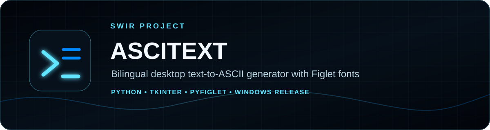
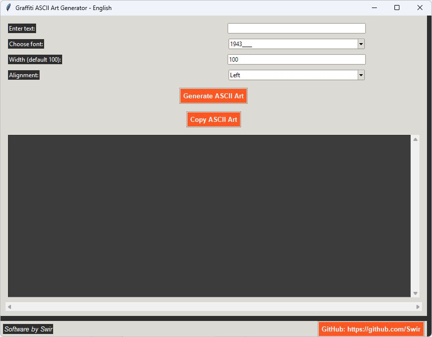
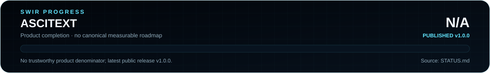

<!-- SWIR-README-STANDARD:v2 -->

<div align="center">



<br>


[](https://github.com/Swir)
[](https://github.com/Swir/ASCITEXT/stargazers)

<br>

[**Highlights**](#-highlights) · [**Quick Start**](#-quick-start) · [**Languages**](#-language-versions) · [**Status**](STATUS.md) · [**Releases**](#-releases)

</div>

## 📸 Screenshot — earlier interface



Initial ASCII art generator window on Windows.


## 📍 Project Status



| Item | Status |
|---|---|
| Current source | 1.1.0 — validated PL/EN utility |
| UI | Tkinter / ttk |
| Text engine | pyfiglet |
| Languages | Polish and English launchers with a shared implementation |
| Latest public release | [Latest verified release](https://github.com/Swir/ASCITEXT/releases/latest) |
| Product completion | **N/A** — no canonical measurable roadmap/denominator exists |
| Detailed status | [STATUS.md](STATUS.md) |

The release version, font count, package size and documentation completeness are not treated as product-completion percentages.

## 🚀 Overview

**ASCITEXT** is a lightweight desktop utility that turns ordinary text into Figlet-style ASCII artwork. Both language launchers use the shared `ascii_app.py` Tkinter application. Users can choose from the fonts exposed by `pyfiglet`, set output width and alignment, generate text art and copy the result to the clipboard.

The application's own ASCII artwork is a core feature. The project's documentation progress visualization, however, follows the SWIR SVG-only standard and does not use character-art progress meters.

## ✨ Highlights

| Feature | What it does |
|---|---|
| 🔤 Text to ASCII | Converts normal text into Figlet-style ASCII output |
| 🎭 Figlet font list | Loads the fonts available through `pyfiglet.FigletFont.getFonts()` |
| ↔️ Width control | Accepts an integer width from 10 to 500, with inline validation |
| 📐 Alignment | Supports left, center and right output alignment |
| 📋 Clipboard | Copies generated output using Tk and reports clipboard errors |
| 🌙 Desktop UI | Uses Tkinter/ttk with a dark interface and scrollable result area |
| 🌍 PL / EN | Provides separate Polish and English program files |
| 🔗 Author shortcut | Opens the Swir GitHub profile from the application |

## ⚙️ Quick Start

### Recommended — Windows release

Download the [latest verified Windows release](https://github.com/Swir/ASCITEXT/releases/latest). New packages include PL/EN executables, a portable ZIP, `SHA256SUMS.txt`, build provenance and runtime verification results. Source changes for 1.1.0 are listed in [CHANGELOG.md](CHANGELOG.md).

### From source

```bash
git clone https://github.com/Swir/ASCITEXT.git
cd ASCITEXT
python -m pip install -r requirements.txt
```

Run English:

```bash
python ASCItext_EN.py
```

Run Polish:

```bash
python ASCItext.py
```

## 📋 Requirements / Compatibility

- Python with Tkinter available.
- Runtime packages: `pyfiglet`; clipboard support comes from Tkinter.
- The current release workflow builds and syntax-checks both applications using **Python 3.11** on `windows-latest`.
- Published packages target Windows x64.
- Broader Python-version compatibility is not claimed here because the repository does not currently maintain a cross-version test matrix.

## 🌍 Language Versions

| Language | Source file | Release asset |
|---|---|---|
| 🇵🇱 Polish | `ASCItext.py` | `ASCITEXT-PL.exe` |
| 🇬🇧 English | `ASCItext_EN.py` | `ASCITEXT-EN.exe` |

Both versions expose the same main workflow: enter text, choose a Figlet font, set width/alignment, generate output and copy it.

## 🎮 Usage / Workflow

1. Enter non-empty text in the input field (up to 500 characters).
2. Choose a font from the `pyfiglet` font list.
3. Set an integer width from 10 to 500. Invalid input is reported instead of silently changing the width.
4. Choose left, center or right alignment.
5. Generate the ASCII artwork.
6. Copy the result to the clipboard when needed.

## 🧠 Technology / Architecture

| Layer | Technology / role |
|---|---|
| GUI | Tkinter + ttk + `ScrolledText` |
| ASCII rendering | pyfiglet |
| Clipboard | Tkinter, with empty-result and unavailable-clipboard handling |
| Browser shortcut | Python `webbrowser` |
| Packaging | PyInstaller in GitHub Actions |
| Release verification | `py_compile` for both source files before Windows builds |

```text
ASCITEXT/
├── ASCItext.py       # Polish version
├── ASCItext_EN.py    # English launcher
├── ascii_app.py      # Shared rendering and PL/EN interface
├── STATUS.md         # truthful product status / progress source note
├── assets/
│   ├── app_icon.svg
│   └── readme/
│       ├── hero.svg
│       ├── progress-card.svg
│       ├── progress-mini.svg
│       └── progress-template.svg
├── tools/
│   └── readme_progress.py
└── .github/workflows/
```

## 🧪 Documentation Verification

```bash
python tools/readme_progress.py --check
```

The docs-only workflow checks generated SVG files, required embeddings and retired **documentation progress-meter** patterns. It intentionally does not reject ASCII artwork created by the application itself.

## 📦 Releases

Windows download: **[latest verified release](https://github.com/Swir/ASCITEXT/releases/latest)**. Source version: **1.1.0**.

Verified release assets include:

- `ASCITEXT-EN.exe`
- `ASCITEXT-PL.exe`
- `ASCITEXT-v1.1.0-Windows-x64.zip`
- `SHA256SUMS.txt`

The release workflow compiles both source files, builds both Windows EXEs with PyInstaller, packages the ZIP and writes its SHA256 checksum.

## ⚠️ Limitations

- Both language launchers share one renderer and interface. Some Unicode characters may be absent from the chosen FIGlet font; an empty rendered result is reported as an error.
- Font availability is determined by the installed `pyfiglet` package.
- The repository has no canonical measurable product roadmap, so product-completion progress remains **N/A** instead of being inferred from the v1.0.0 release.

## 🧪 Verification

```powershell
python -m unittest discover -s tests -v
python ASCItext.py --self-test ascii-pl-self-test.json
python ASCItext_EN.py --self-test ascii-en-self-test.json
```

Release checks repeat the hidden-window render test inside both frozen EXEs, including bundled fonts, three alignments and invalid input. The fresh draft ZIP is downloaded and checked before publication.

## 🔎 Search Keywords

`ascii art generator` • `ascii text generator` • `figlet gui` • `pyfiglet gui` • `python ascii generator` • `tkinter ascii art` • `text to ascii art` • `terminal banner generator` • `ascii logo maker` • `python desktop text tool` • `figlet desktop app` • `bilingual ascii generator` • `windows ascii art app` • `offline ascii art` • `ascitext`


<div align="center">


### `TYPE • RENDER • COPY`

⭐ **If ASCITEXT is useful, consider leaving a star.**

[**← SWIR profile**](https://github.com/Swir) · [**All projects →**](https://github.com/Swir?tab=repositories)

</div>
